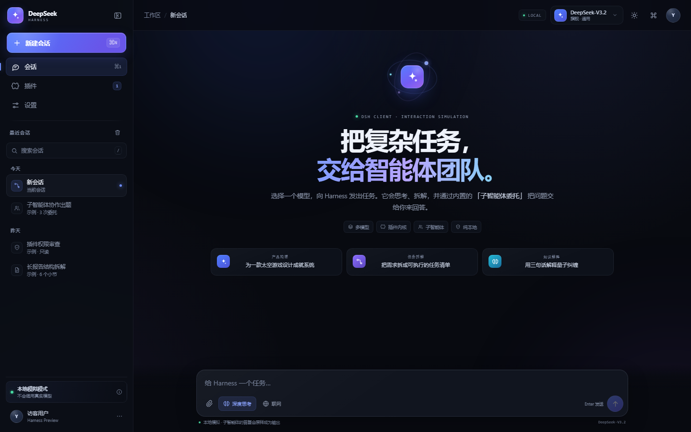
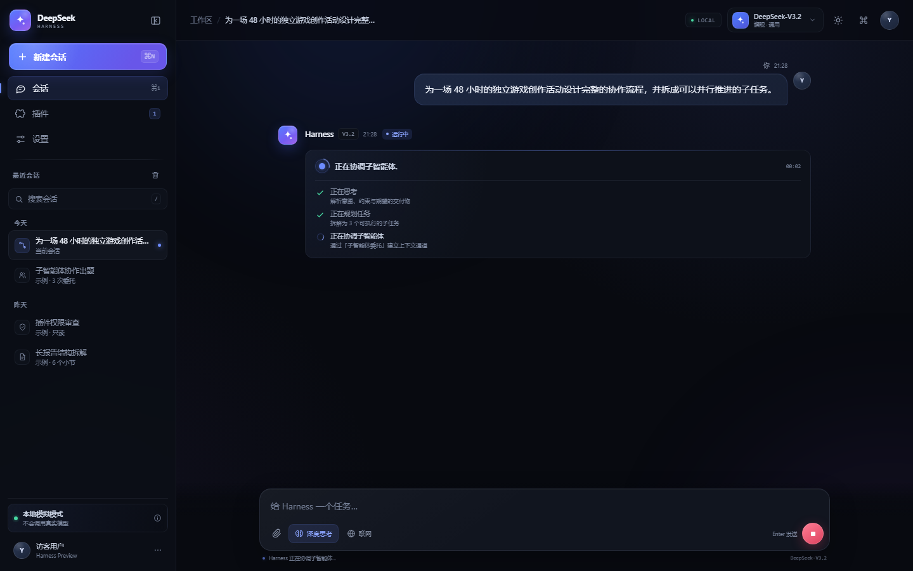
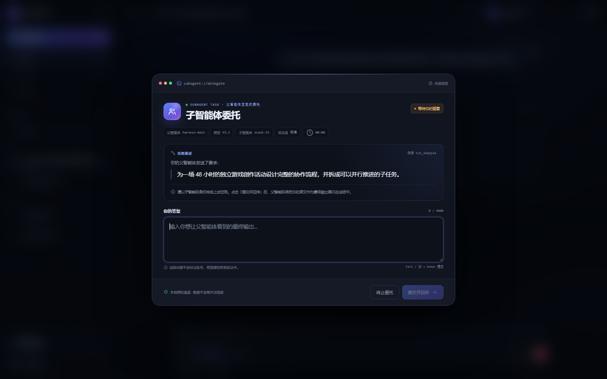
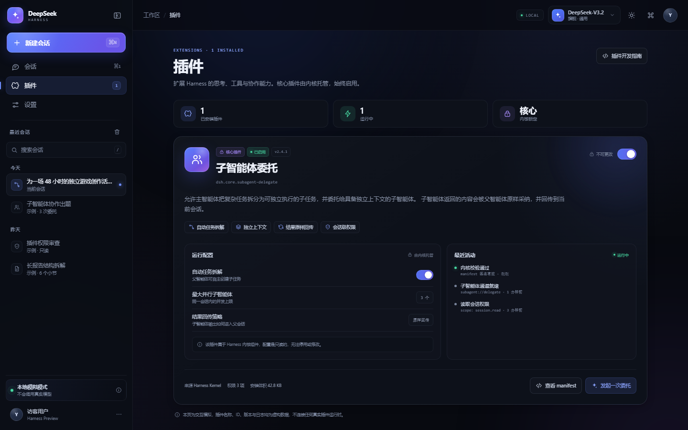
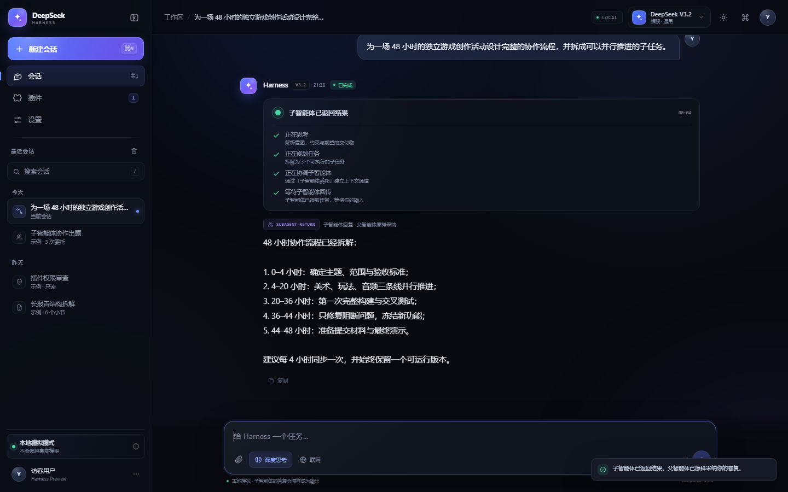
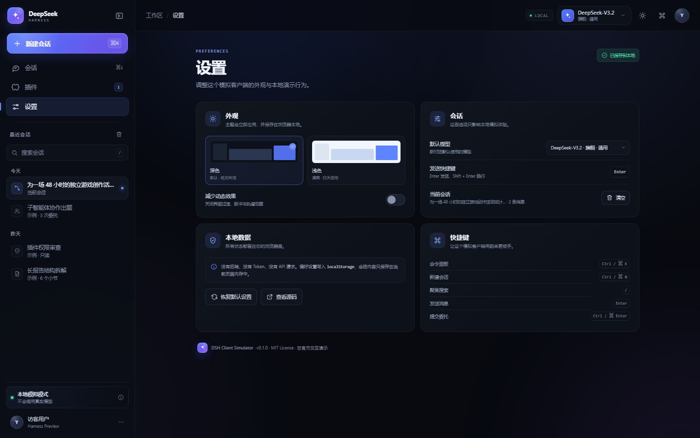
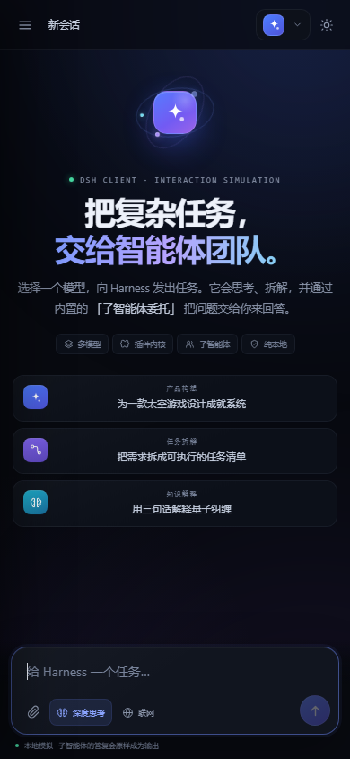

# DSH Client Simulator

> 一个纯前端的 **DeepSeek Harness 客户端交互模拟**：选择模型、发出任务，看 Harness 思考并协调子智能体，然后亲自以子智能体身份完成一次弹窗委托。

[](https://yx333221c.github.io/dsh-client-sim/)
[](LICENSE)
[](#本地运行)
[](#技术栈)



> 这是一个非官方的、纯本地的前端交互演示，与 DeepSeek 官方无关。页面中的插件、日志、模型状态与任务数据均为虚构演示数据。

## 这是什么？

DSH Client Simulator 复刻了一个“看起来像真的”的 DeepSeek Harness 客户端：

- 侧边栏、会话、模型选择器、插件页、设置页、命令面板、通知与响应式布局一应俱全。
- 选择模型并发送问题后，Harness 会依次显示 **正在思考 → 正在规划任务 → 正在协调子智能体 → 等待子智能体回传**。
- 随后屏幕中央会弹出一个 **子智能体委托窗口**，把刚刚输入的问题作为任务描述，并附上“你的父智能体发送了要求：”等固定提示。
- 你在弹窗里输入的内容会被 **原样** 作为最终输出展示回会话，父智能体不会改写你的答复。
- 插件页只有一个核心插件「子智能体委托」，它默认启用，并且被内核锁定，无法停用或修改配置。

整个项目没有任何后端、没有 API Key、不发起真实模型请求。打开 HTML 就能玩。

## 交互流程

1. 在右上角选择模型（DeepSeek-V3.2 / DeepSeek-R1 / DeepSeek-V3.1 / Harness-Lite）。
2. 在底部输入框输入一个问题，或者点击首页示例卡片。
3. 点击发送，观察 Harness 的思考与协调状态。
4. 几秒后，子智能体委托窗口弹出：
   - **任务描述** 是刚刚输入的问题；
   - 顶部会出现“你的父智能体发送了要求：”；
   - 你会看到任务 ID、子智能体代号、优先级等随机演示信息。
5. 输入答复并点击 **提交并回传**。
6. 你的输入会原样成为会话中的最终回答，并标记为“子智能体回复 · 父智能体原样采纳”。

<table>
  <tr>
    <td width="50%"></td>
    <td width="50%"></td>
  </tr>
  <tr>
    <td align="center"><sub>思考与协调状态</sub></td>
    <td align="center"><sub>子智能体委托窗口</sub></td>
  </tr>
</table>

## 插件：子智能体委托

插件页展示了一个 **不能更改且始终启用** 的核心插件示例：

| 字段 | 值 |
| --- | --- |
| 名称 | 子智能体委托 |
| 插件 ID | `dsh.core.subagent-delegate` |
| 版本 | `2.4.1` |
| 发布者 | `harness-kernel` |
| 状态 | 已启用 / 内核锁定 / 不可更改 |
| 权限 | `session.read`、`subagent.create`、`result.write` |
| 描述 | 允许主智能体把复杂任务拆分为可独立执行的子任务，并委托给具备独立上下文的子智能体。子智能体返回的内容会被父智能体原样采纳，并回传到当前会话。 |



插件页还包含：

- 点击也不会改变的锁定开关（会提示“由 Harness 内核托管”）；
- 只读运行配置：自动任务拆解、最大并行子智能体、结果回传策略；
- 插件活动日志；
- “查看 manifest” 弹窗；
- “发起一次委托”快捷入口。

## 更多界面

| 回传结果 | 设置页 |
| --- | --- |
|  |  |

移动端也会自动切为抽屉式侧边栏与单列布局：

<p align="center">
  
</p>

## 功能一览

- **DSH 风格界面**：暗色默认主题、层次化面板、环境光、细腻的 CSS 动画。
- **模型选择器**：四个虚构配置的模型条目，选择后立即同步到输入框与消息元数据。
- **智能体状态流**：思考、规划、协调、等待回传四个阶段，带计时和逐条勾选。
- **子智能体委托窗口**：固定父智能体提示语、原始问题、任务 ID、随机子智能体代号、答复输入与字符计数。
- **原样回传**：最终输出的 DOM 文本与你提交的文本完全一致，支持复制。
- **锁定核心插件**：启用的开关不可更改，配置只读，manifest 可查看、可复制。
- **会话示例**：侧边栏内置三个静态示例会话，可在示例与当前会话之间切换。
- **命令面板**：`Ctrl/⌘ + K` 搜索命令、模型切换和页面导航。
- **主题与无障碍**：深色 / 浅色主题、减少动态效果、焦点圈、`aria-live`、弹窗焦点陷阱。
- **纯静态部署**：无依赖、无构建、无网络请求，可直接托管在 GitHub Pages。

## 本地运行

克隆仓库：

```bash
git clone https://github.com/yx333221c/dsh-client-sim.git
cd dsh-client-sim
```

任选一种方式启动静态服务器：

```bash
# Python 3
python -m http.server 8787

# 或者 Node.js
npx serve . -l 8787
```

然后打开 <http://127.0.0.1:8787/>。

也可以直接双击 `index.html` 打开，但用本地服务器体验更接近真实站点。

## 技术栈

- HTML5
- 原生 CSS（自定义属性、Grid、Flex、`backdrop-filter`、`color-mix`）
- 原生 JavaScript（无框架、无打包器）
- 内联 SVG symbol 图标
- `localStorage` 保存主题、模型、动效与侧边栏偏好

## 项目结构

```text
dsh-client-sim/
├── index.html                  # 页面骨架、图标 sprite、三个主要视图
├── styles.css                  # 设计系统、布局、动画、响应式与主题
├── app.js                      # 状态机、会话、委托流程、弹窗与命令面板
├── assets/
│   ├── favicon.svg
│   └── preview-*.png           # README 截图
├── LICENSE
└── README.md
```

## 快捷键

| 操作 | 快捷键 |
| --- | --- |
| 打开命令面板 | `Ctrl / ⌘ + K` |
| 新建会话 | `Ctrl / ⌘ + N` |
| 切换会话 / 插件 / 设置 | `Ctrl / ⌘ + 1 / 2 / 3` |
| 聚焦会话搜索 | `/` |
| 发送消息 | `Enter` |
| 换行 | `Shift + Enter` |
| 提交子智能体答复 | `Ctrl / ⌘ + Enter` |

## 部署到 GitHub Pages

仓库根目录就是可发布的静态站点，已通过 **Deploy from a branch** 配置为从 `main` 分支根目录发布。

如果 fork 后需要重新配置：

1. 打开仓库 **Settings → Pages**；
2. 在 **Build and deployment** 中选择 **Deploy from a branch**；
3. 分支选择 `main`，目录选择 `/ (root)`，保存即可；
4. 稍等片刻，通过 <https://yx333221c.github.io/dsh-client-sim/> 访问。

也可以把仓库根目录直接交给任意静态托管服务（Vercel、Netlify、Cloudflare Pages、Nginx 等）。

## 说明

- 这是一个**前端交互模拟**，不会调用任何真实模型 API。页面上的“思考”和“协调”均由定时器驱动。
- 插件名称、插件 ID、版本号、权限、日志、任务 ID、子智能体代号等均为虚构演示数据。
- 输入内容只保留在当前页面的内存中；“子智能体答复”不会上传到任何服务器。
- 这是非官方项目，不代表 DeepSeek 官方立场，也不包含 DeepSeek 的商标授权。

## License

[MIT](LICENSE) © 2026 yx333221c
